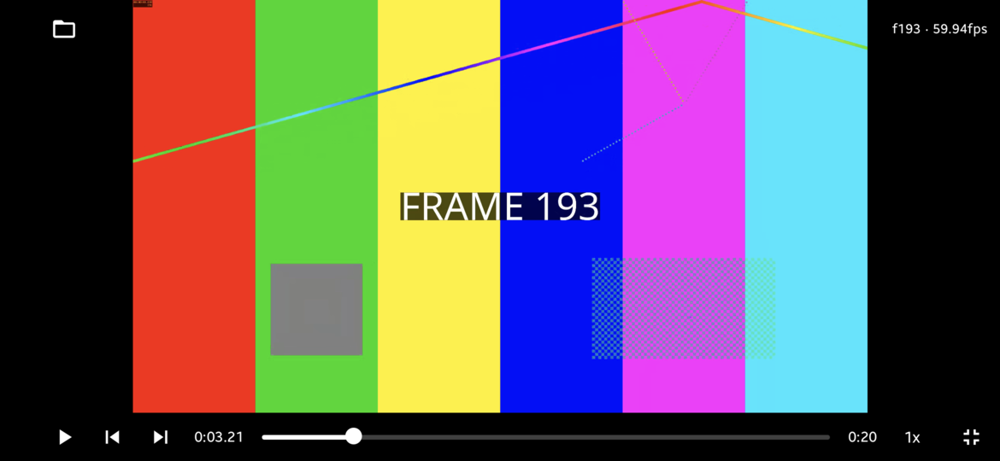
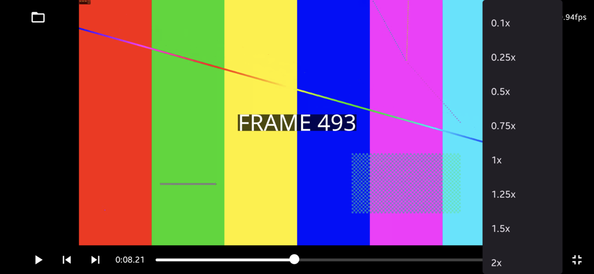
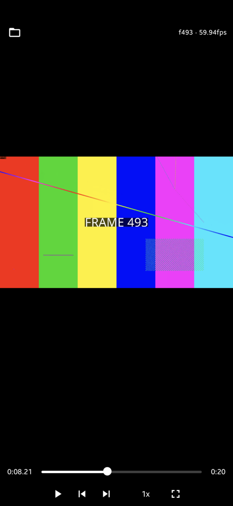

# Futsal Player

A minimal Android video player for reviewing futsal footage (e.g. GoPro wide view) frame by frame.



 

The screenshots use a generated test clip with the frame number burned in; the `f193` label at the top right matches the frame on screen.

## Features

- **Controls never auto-hide** — play/pause and frame step stay on screen.
- **Fullscreen button** rotates to landscape (and back to portrait), like YouTube. Wide videos open in fullscreen automatically.
- **Frame-accurate stepping** — `|◀` / `▶|` move exactly one frame (uses the file's real frame rate). Hold to repeat.
- **Pinch to zoom** (up to 10×) and drag to pan while zoomed. Tap `N× reset` to go back.
- **Double tap** left / right half of the video: −5s / +5s.
- **Playback speed**: 0.1x – 2x.
- Current frame number and fps shown at the top right.

## Opening videos

- Folder icon → system file picker (local storage; Google Photos / Drive are available from its side menu).
- From Google Photos: **Share** or **Open with** → Futsal Player.

## Build

```sh
./gradlew assembleDebug        # app/build/outputs/apk/debug/app-debug.apk
./gradlew assembleRelease      # minified, signed with the debug key for sideloading
adb install -r app/build/outputs/apk/release/app-release.apk
```

Built with Kotlin, Jetpack Compose and Media3 ExoPlayer.
